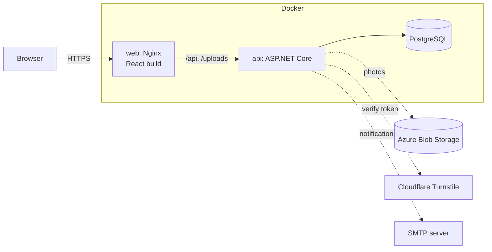

# Auto Luki: Car Dealership Website

A production-ready website for a small used-car dealership in Kosovo. Visitors browse cars and contact the dealer without an account; the owner manages cars, photos and inquiries from an admin panel.

**Live:** _coming soon_ · **Stack:** ASP.NET Core 10 · EF Core · PostgreSQL · React + TypeScript · Tailwind CSS · Docker

<!-- Screenshots: add docs/screenshots/*.png here once real car photos are online. -->

## Features

**Public (no login)**
- Car listing with text search, filters (brand, model, year, price, mileage, fuel, transmission, body type), sorting and pagination. Filters live in the URL, so a search can be shared on WhatsApp.
- Car detail page with photo gallery (fullscreen viewer, swipe on mobile) and full specifications
- Link previews: a car link shared on WhatsApp, Facebook or Viber shows the car's photo, name and price
- Call and WhatsApp buttons (WhatsApp message is pre-filled with the car and its link)
- Inquiry and test-drive form, protected by Cloudflare Turnstile and per-IP rate limiting
- Favorites stored in the browser (no account)
- Albanian and English; responsive, mobile-first

**Admin (JWT login, roles Admin / Staff)**
- Add, edit, delete cars; mark as available / sold
- Upload, reorder and delete photos (local disk in development, Azure Blob Storage in production). Every upload is resized to a gallery image and a small thumbnail, and its hidden metadata (such as GPS location) is removed
- Manage inquiries; email notification for each new inquiry
- Dashboard: cars in stock, sold (total and this month), new inquiries

## Architecture



The backend follows a lightweight Clean Architecture. Dependencies point inward, so business logic knows nothing about PostgreSQL, Azure or HTTP:

| Project | Responsibility | Depends on |
|---|---|---|
| `AutoLuki.Domain` | Entities and enums, status rules (`car.MarkAsSold(now)`) | nothing |
| `AutoLuki.Application` | Services, DTOs, FluentValidation validators, interfaces (`IAppDbContext`, `IFileStorage`, `IEmailSender`) | Domain |
| `AutoLuki.Infrastructure` | EF Core + migrations, Identity + JWT, Azure Blob / local storage, SMTP, Turnstile | Application |
| `AutoLuki.Api` | Controllers, auth policies, rate limiting, error handling, startup | Application, Infrastructure |
| `frontend/` | React + TypeScript (Vite), TanStack Query, React Router, Tailwind, i18next | API over HTTP |

Database design: [docs/database-design.md](docs/database-design.md).

## Running locally

**Requirements:** .NET 10 SDK, Node 24, Docker.

### Option 1: everything in Docker
```bash
cp .env.example .env          # then edit the values
docker compose up -d --build
```
Website: http://localhost:8080 (change `WEB_PORT` in `.env` if the port is taken). Admin: `/admin`, using `ADMIN_EMAIL` / `ADMIN_PASSWORD` from `.env`.

### Option 2: development (hot reload)
```bash
cp .env.example .env
docker compose up -d db                     # PostgreSQL only

cd src/AutoLuki.Api                         # API secrets live in user-secrets, never in the repo
dotnet user-secrets set "ConnectionStrings:Default" "Host=localhost;Database=autoluki;Username=autoluki;Password=<POSTGRES_PASSWORD>"
dotnet user-secrets set "Jwt:SigningKey" "<at least 32 random characters>"
dotnet user-secrets set "AdminSeed:Email" "admin@example.com"
dotnet user-secrets set "AdminSeed:Password" "<strong password>"
dotnet run                                  # http://localhost:5228, Swagger at /swagger

cd ../../frontend
npm install
npm run dev                                 # http://localhost:5173 (proxies /api to the API)
```
Migrations run automatically on startup in Development. In development, photos are stored in `src/AutoLuki.Api/uploads/`, emails are written to the log, and Turnstile uses Cloudflare's test keys.

### Demo data
To fill an empty site with 16 example cars (invented listings, photos from Wikimedia Commons):
```bash
node --env-file=.env tools/demo-data/seed.mjs
```
The script logs in with `ADMIN_EMAIL` / `ADMIN_PASSWORD` and creates the cars through the admin API. It refuses to run if the site already has cars (override with `--force`). Photo credits: [docs/demo-photo-credits.md](docs/demo-photo-credits.md). Demo data is for local use and screenshots only, never for the live dealership site.

## Configuration

All settings come from environment variables (`Section__Key`) or user secrets; nothing secret is committed.

| Setting | Purpose |
|---|---|
| `ConnectionStrings__Default` | PostgreSQL connection |
| `Jwt__SigningKey` | HMAC key for admin tokens (≥ 32 chars). The app refuses to start without it |
| `AdminSeed__Email`, `AdminSeed__Password` | First admin, created once if no admin exists |
| `Turnstile__SecretKey` | Cloudflare Turnstile server key |
| `Storage__Provider` | `Local` or `Azure` (+ `Storage__AzureConnectionString`) |
| `Email__SmtpHost`, `Email__NotificationAddress`, … | Inquiry email notifications (logged only if no SMTP host) |
| `RateLimits__InquiryPermitLimit`, … | Rate limits, tunable without a code change |
| `Database__MigrateOnStartup` | Apply EF Core migrations at startup (single-instance deployments) |

## Tests

```bash
dotnet test        # needs Docker running (integration tests start PostgreSQL)
```
- **Unit tests (50):** validators, domain status rules, image-type detection. A fake clock (`FakeTimeProvider`) keeps date rules deterministic.
- **Integration tests (44):** the real API in memory (`WebApplicationFactory`) against a real PostgreSQL in a throwaway container (Testcontainers). They cover auth and roles, filters with paging, VIN privacy, sold and deleted cars, photo resizing and fake-image rejection, link-preview pages (including HTML-encoding), the admin account following configuration, inquiries with spam checks, dashboard counts and rate limiting.

CI (GitHub Actions) runs the backend tests, frontend lint and build, and both Docker image builds on every push and pull request.

## Key decisions

| Decision | Why |
|---|---|
| **PostgreSQL** | Free, runs in Docker, cheap managed hosting; first-class EF Core provider |
| **Brands/Models as lookup tables** | Free text produces "VW" vs "Volkswagen" duplicates and broken filters |
| **Enums stored as strings** | Readable data; reordering a C# enum can never silently corrupt rows |
| **Soft delete for cars** | Mistakes are recoverable; inquiries keep their link. Implemented with an EF Core global query filter |
| **No repository layer over EF Core** | `DbContext` already is a repository + unit of work; services use an `IAppDbContext` interface |
| **No AutoMapper** | LINQ `.Select()` projections into DTOs are explicit, compile-time checked, and fetch only needed columns |
| **Validation in the service layer** (FluentValidation) | Business rules protect themselves regardless of caller; a global `IExceptionHandler` maps errors to RFC 9457 ProblemDetails |
| **Separate public and admin DTOs** | Private fields (VIN) cannot leak by accident |
| **`/api/admin/*` with class-level `[Authorize]`** | The security boundary is visible in the URL and cannot be lost on a single method |
| **JWT with 8h lifetime, no refresh tokens** | One or two admins; refresh-token rotation would add complexity without real benefit |
| **Photos: random blob names + magic-byte check** | Never trust client file names (path traversal) or content types (disguised executables) |
| **Resize on upload** (SkiaSharp) | A 6 MB phone photo becomes a ~250 KB JPEG plus a ~45 KB WebP thumbnail, so the list loads fast on mobile data. Re-encoding strips EXIF (GPS), fixes orientation and proves the file is a real image; dimensions are checked before decoding to block decompression bombs. SkiaSharp was chosen for its MIT license (ImageSharp 4 needs a paid key for Release builds) |
| **Link previews by dynamic rendering** | Preview bots do not run JavaScript, so Nginx sends them (by User-Agent) to a small API page with Open Graph tags; people and search engines get the React app. All values are HTML-encoded |
| **Native `<dialog>` for the photo viewer** | Focus trap, Escape and screen-reader semantics come from the browser instead of a library |
| **Store blob names, not URLs** | Switching storage account or adding a CDN needs no data migration |
| **Background email queue** (`Channel` + `BackgroundService`) | Visitors get an instant response; an SMTP failure can never lose an inquiry, which is saved first |
| **Turnstile verified on the server** | A browser-only check can be skipped by bots; fails closed if Cloudflare is unreachable |
| **Filters in the URL** (React) | Shareable searches; Back and Refresh keep the filters |
| **Lazy-loaded admin pages** | Visitors never download admin code |
| **Nginx in front, same origin** | No CORS configuration; overwrites `X-Forwarded-For` so clients cannot spoof their IP to dodge rate limits |
| **Real PostgreSQL in tests** | EF InMemory behaves differently from a real database, so tests could pass while production fails |
