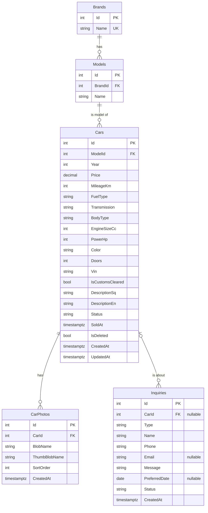

# Database Design

Database: **PostgreSQL** (accessed via EF Core, code-first migrations).

## Entity diagram

Admin users are stored in the standard ASP.NET Core Identity tables (`AspNetUsers`, `AspNetRoles`, ...), which EF Core generates. We do not design those ourselves.

## Tables

### Brands / Models (lookup tables)
| Column | Type | Notes |
|---|---|---|
| Id | int, PK | |
| Name | varchar(50), required | Unique on Brands; unique per (BrandId, Name) on Models |
| BrandId | int, FK → Brands | Models only. `ON DELETE RESTRICT` |

### Cars
| Column | Type | Notes |
|---|---|---|
| Id | int, PK, identity | |
| ModelId | int, FK → Models, required | Brand is reached through Model. `ON DELETE RESTRICT` |
| Year | int, required | Check: 1950 to current year + 1 |
| Price | numeric(10,2), required | In EUR. Check: > 0 |
| MileageKm | int, required | Check: >= 0 |
| FuelType | varchar(20), required | Enum stored as string: Petrol, Diesel, Hybrid, Electric, LPG |
| Transmission | varchar(20), required | Enum: Manual, Automatic |
| BodyType | varchar(20), required | Enum: Sedan, Hatchback, SUV, Wagon, Coupe, Van, ... |
| EngineSizeCc | int, nullable | Null for electric cars |
| PowerHp | int, nullable | |
| Color | varchar(30), nullable | |
| Doors | int, nullable | |
| Vin | varchar(17), nullable | Admin only, never returned by public API |
| IsCustomsCleared | bool, default false | ("I doganuar"), to be confirmed with the dealer |
| DescriptionSq | varchar(4000), nullable | Albanian description |
| DescriptionEn | varchar(4000), nullable | English description |
| Status | varchar(20), required, default `Available` | Enum: Available, Sold |
| SoldAt | timestamptz, nullable | Set when Status → Sold |
| IsDeleted | bool, default false | Soft delete. Global query filter in EF Core |
| CreatedAt | timestamptz, required | UTC, set by the app |
| UpdatedAt | timestamptz, required | UTC, set by the app |

### CarPhotos
| Column | Type | Notes |
|---|---|---|
| Id | int, PK | |
| CarId | int, FK → Cars, required | `ON DELETE CASCADE` |
| BlobName | varchar(200), required | Path inside blob container, not the full URL |
| ThumbBlobName | varchar(200), nullable | Small WebP version for lists. Null for photos uploaded before thumbnails existed |
| SortOrder | int, required | 0 = main/cover photo |
| CreatedAt | timestamptz, required | |

### Inquiries
| Column | Type | Notes |
|---|---|---|
| Id | int, PK | |
| CarId | int, FK → Cars, nullable | Null = general inquiry. `ON DELETE SET NULL` |
| Type | varchar(20), required | Enum: General, TestDrive |
| Name | varchar(100), required | |
| Phone | varchar(30), required | |
| Email | varchar(150), nullable | |
| Message | varchar(2000), required | |
| PreferredDate | date, nullable | Test-drive requests only |
| Status | varchar(20), required, default `New` | Enum: New, Contacted, Closed |
| CreatedAt | timestamptz, required | |

## Indexes

| Table | Index | Why |
|---|---|---|
| Brands | unique (Name) | No duplicate brands |
| Models | unique (BrandId, Name) | No duplicate models per brand; also serves FK lookups |
| Cars | (ModelId) | Brand/model filter + FK |
| Cars | (Status, CreatedAt DESC) | Default listing: available cars, newest first |
| Cars | (Price) | Price range filter and sort |
| Cars | (Year) | Year filter and sort |
| Cars | (MileageKm) | Mileage filter and sort |
| CarPhotos | (CarId, SortOrder) | Load a car's gallery in order |
| Inquiries | (Status, CreatedAt DESC) | Admin inbox: new inquiries first |
| Inquiries | (CarId) | Inquiries for a car + FK |

FuelType and Transmission are not indexed: they have only a few distinct values, so an index would rarely be used. Add indexes later if real query plans show a need.
